<div align="center">


# ZeeShell

**A complete desktop shell for [Hyprland](https://hypr.land), built with [Quickshell](https://quickshell.org).**

Glass panels, colours taken from your wallpaper, motion everywhere,<br>
and a Settings panel instead of config files.

[](LICENSE)


[Quick start](#quick-start) · [Tour](#tour) · [Install](#install) · [Keys and commands](#using-it) · [Development](#development)

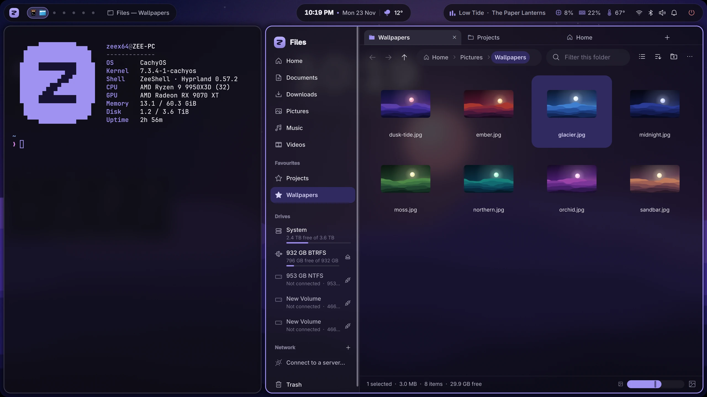

</div>

## What it is

ZeeShell replaces the usual pile of separate tools (bar, launcher, notification
daemon, lock screen, wallpaper setter, settings scripts) with one shell that
looks and moves the same everywhere. It comes with its own file explorer, a
keybind editor for Hyprland, a terminal greeter, and themes for the apps around
it, and one script installs all of it.

Its Settings window covers the whole computer, not just the shell: screens,
sound, network, power, storage, default apps, time and updates sit next to the
bar and theme options. Nearly everything applies as you change it, and the
shell's own settings live in a single JSON file you can also edit by hand.

## Quick start

```bash
git clone https://github.com/zeex64/ZeeShell.git
```

```bash
cd ZeeShell
```

```bash
./install.sh --start
```

No root needed. Then press **Super + Space** for the app drawer, **Super + A**
for quick settings and **Super + ,** for Settings. See [Requirements](#requirements)
first if you are not on Hyprland with Quickshell already, and
[Install](#install) for what the script changes and how to undo it.

## Tour

### Bar and desktop

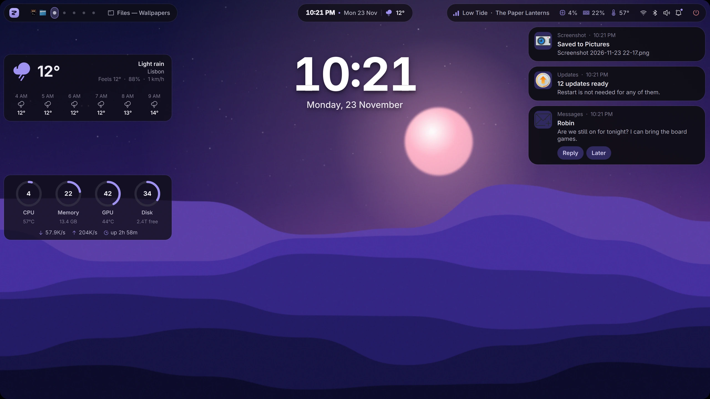

- **Bar** on top or bottom, floating or flush, on one monitor or all of them,
  in three styles (islands, pills, solid). Its modules can be reordered from
  Settings: workspaces (dots, numbers or app icons), window title, clock with
  weather, media, system info, app tray (optionally collapsed behind an arrow),
  status icons and power.
- **Notifications** with actions, swipe to dismiss, do not disturb and a
  history in the side panel. You choose the corner and the monitor.
- **Desktop widgets**: clock, weather, system, media and calendar.
- Volume and brightness indicator, rounded screen corners, startup animation.

### App drawer

<p>
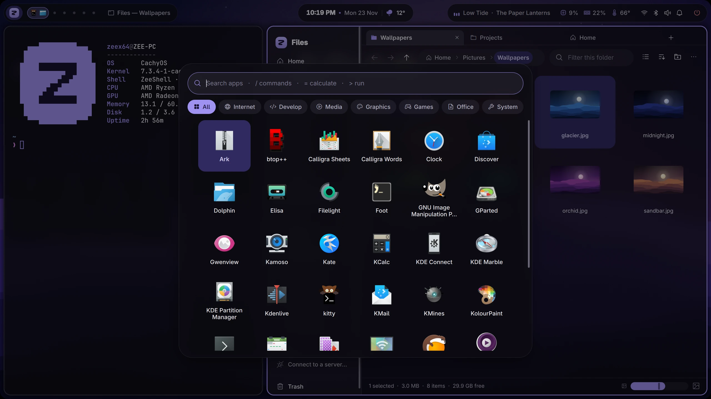
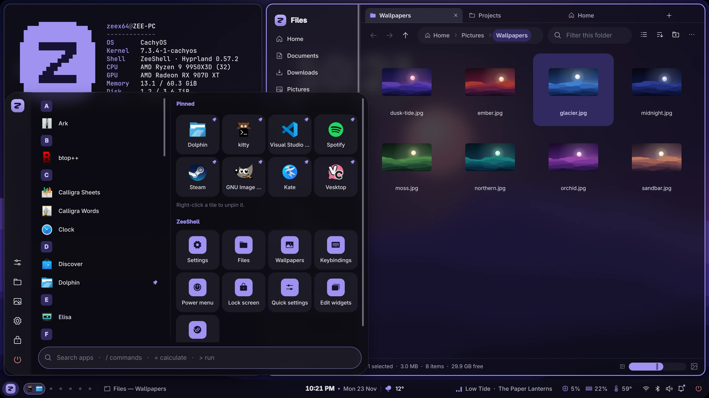
</p>

- Fuzzy search with categories, a calculator (`=`), a command runner (`>`) and
  shell commands (`/`).
- Opens in the centre, as a side panel, or as a start menu at the bottom with
  an A–Z list, pinned apps and the shell's own pages.

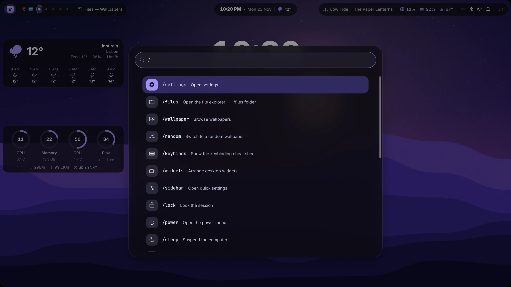

### Quick settings and popups

<p>
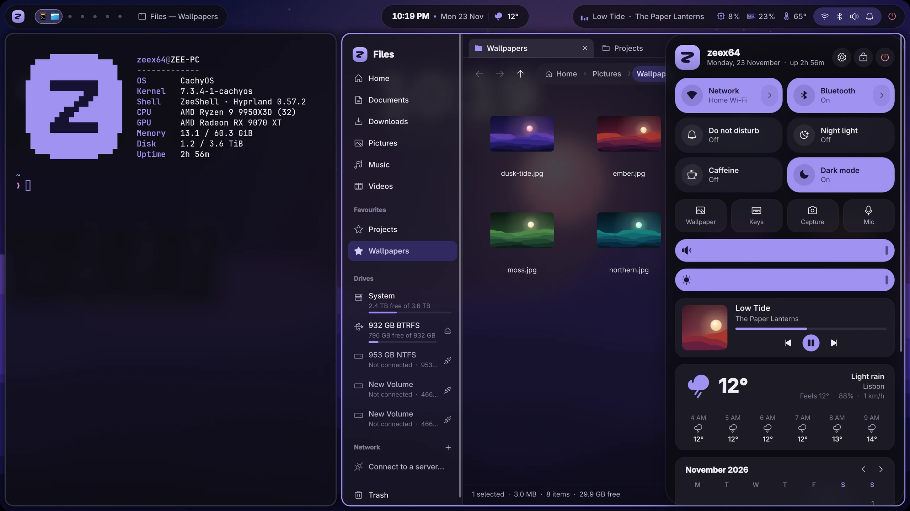
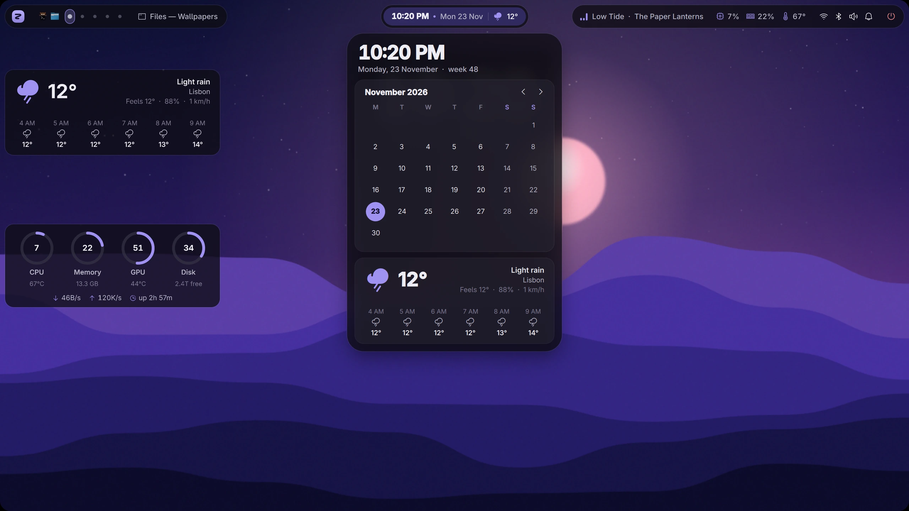
</p>

- **Quick settings**: network and Bluetooth pages, do not disturb, night light,
  caffeine, dark mode, sliders, media, weather, calendar and notification
  history.
- **Popups** under the bar for the calendar, the media player and the tray.

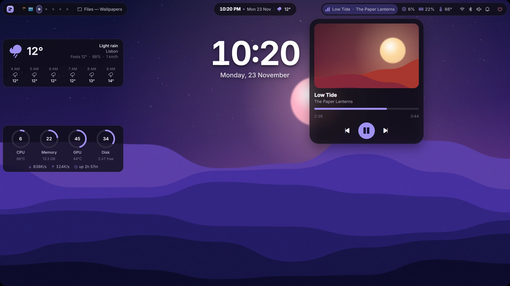

### Settings

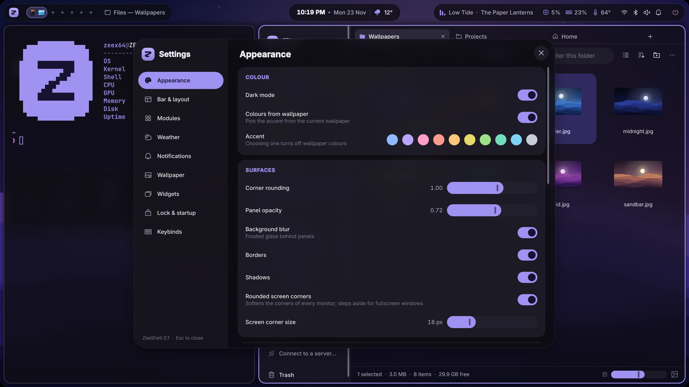

One window for the whole computer. The home page shows the machine at a glance
and a tile for every area with its current state; search finds a setting by
name (`zeeshell find night light` opens it from a terminal).

<p>
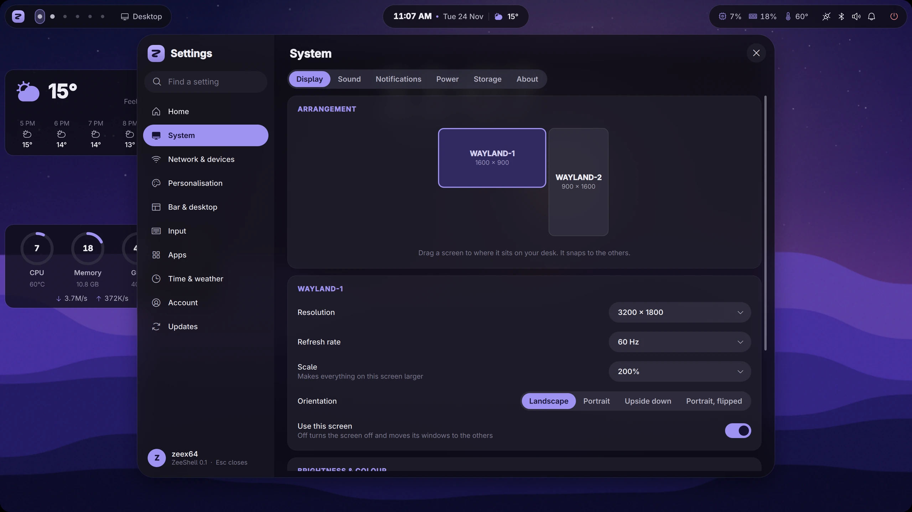
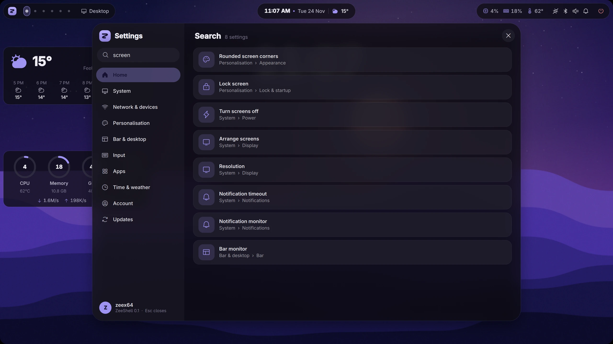
</p>

- **System**: screens (drag them into place; resolution, refresh rate, scale,
  rotation, with a "keep this?" countdown so a bad mode cannot lock you out),
  brightness and night light, sound devices and per-app volume, notifications,
  power mode and what happens when the computer is left alone, storage, and
  the machine's details.
- **Network & devices**: Wi-Fi, connection details, VPN switches, Bluetooth.
- **Personalisation** and **Bar & desktop**: colours, surfaces, window style,
  wallpaper, lock screen, bar layout, modules and widgets.
- **Input**: keyboard layout and typing, mouse and touchpad, keybinds.
- **Apps**: default apps, apps that start with the session, and the built-in
  file explorer and Steam workspace.
- **Time & weather**, **Account** and **Updates** (lists pending pacman, AUR
  and Flatpak updates; installing runs in a terminal).

<p>
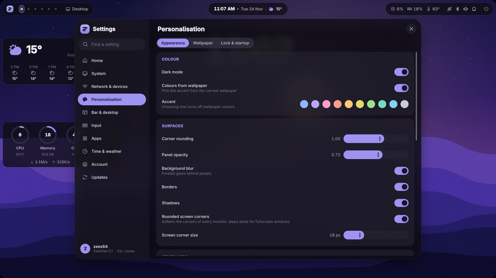
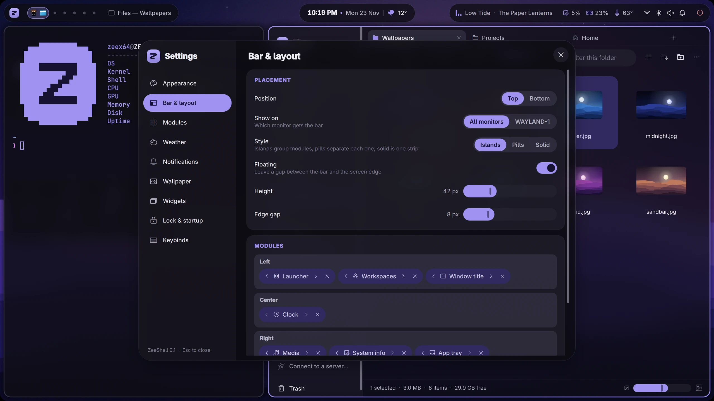
</p>

Display and input changes are applied on top of your Hyprland config, never
written into it, and each of those pages has a "Hand back" button that returns
to what your config says. Anything that needs a password (time zone, device
name, updates, your own password) goes through polkit or a terminal; the shell
never handles one.

### Keybinds

<p>
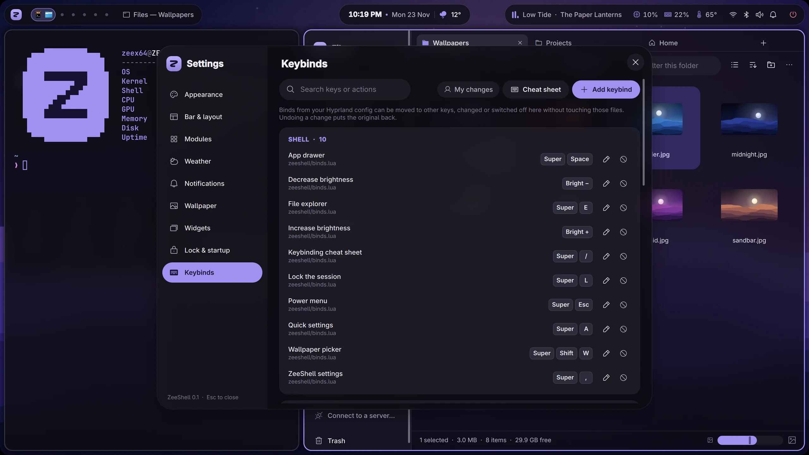
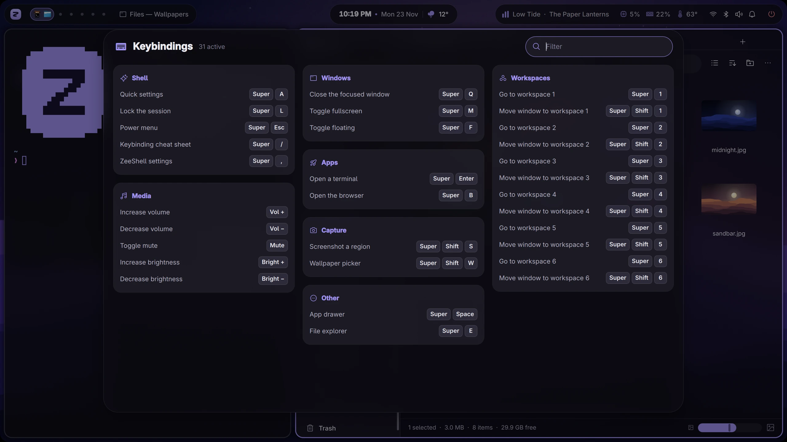
</p>

- **Keybind editor**: lists every Hyprland bind and lets you add, move, change
  or switch them off, without editing your Hyprland config by hand. Bind keys
  to shell actions, apps or your own commands.
- **Cheat sheet** (Super + /) with a filter, grouped by what the keys do.

### Wallpapers and colours

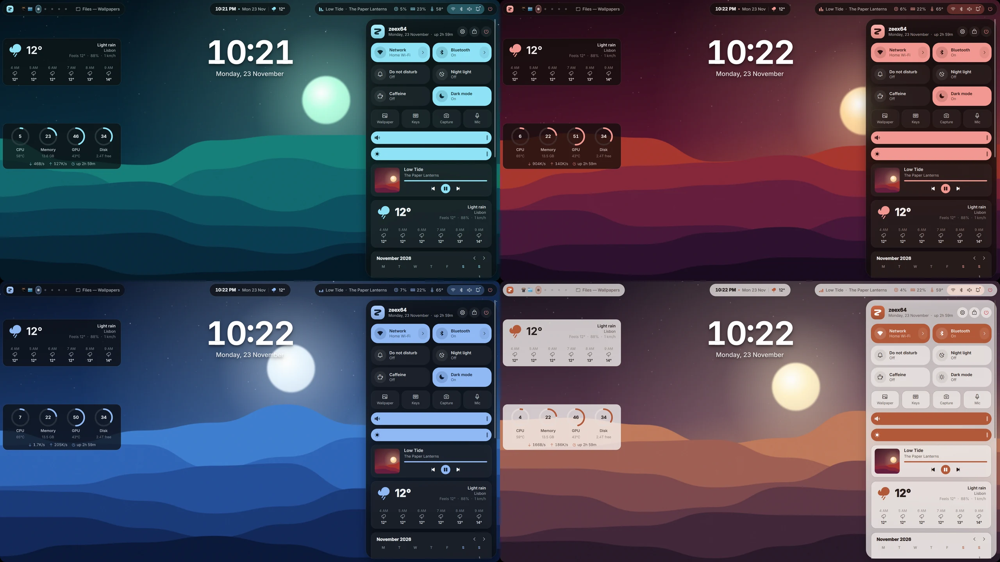

The accent colour comes from the wallpaper, so the whole desktop changes with
it, in dark or light mode. You can also pin an accent of your own.

<p>
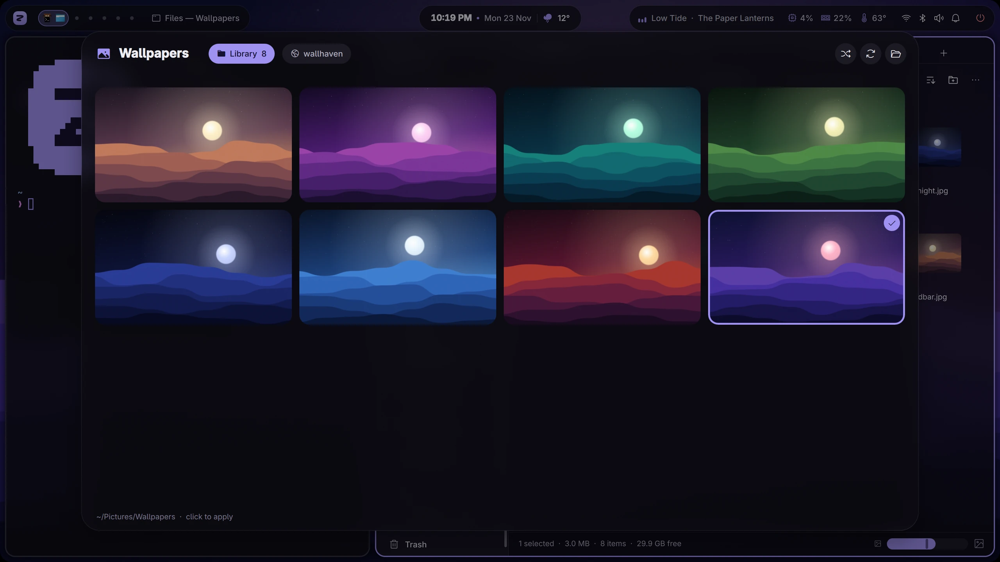
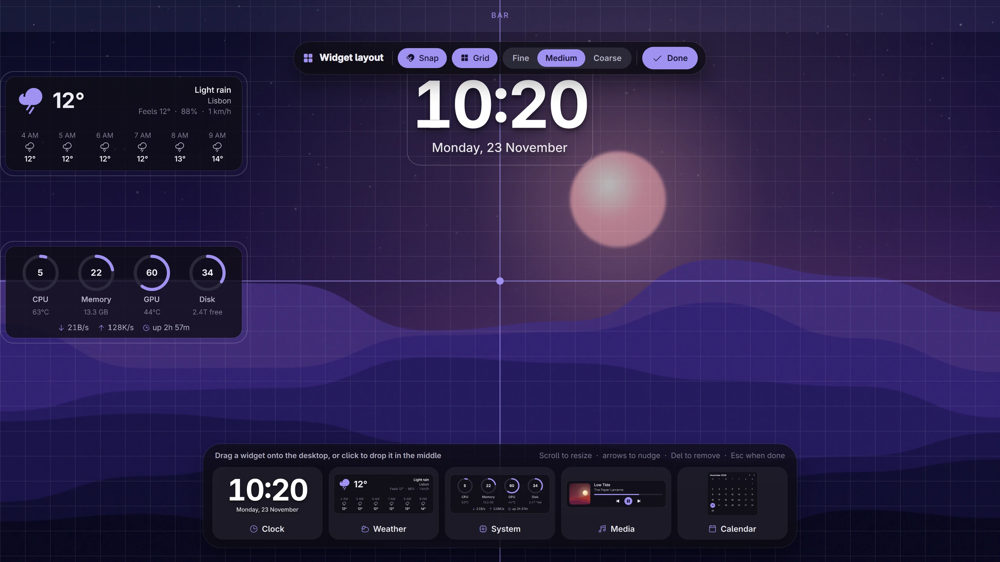
</p>

- **Wallpaper picker** with your own folder and [wallhaven.cc](https://wallhaven.cc)
  search built in.
- **Widget editor**: a full-screen layout mode with a grid, centre lines and
  snapping. Drag widgets in, scroll to resize.
- **Matching apps**: Hyprland's window borders, gaps and rounding follow the
  theme, and so do KDE apps such as Dolphin, kitty and foot. Vesktop (Discord)
  gets a theme in the same style as Settings and Files: a see-through window,
  a lighter strip for navigation, outlined cards and the accent colour. Steam
  gets one too, through [Millennium](https://steambrew.app): pill tabs, the
  shell's cards and switches in the library and settings, and a recolour of
  the store and community pages.

### File explorer and terminal

Both are in the screenshot at the top of this page.

- **File explorer** (`zeeshell files`, Super + E): its own app window in the
  shell's look, with tabs, grid and list views, thumbnails, search, copy / cut /
  paste that never overwrites, trash, and drag and drop. The sidebar has your
  favourites, every drive (connect or disconnect with one click) and network
  locations.
- **Terminal greeter** (`zeeshell fetch`): the ZeeShell mark next to this
  machine's specs, in the shell's colours.

### Lock screen and power menu

<p>
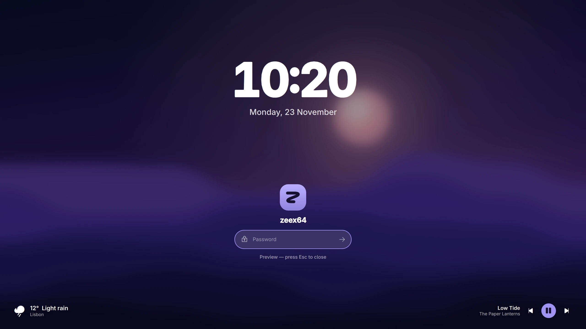
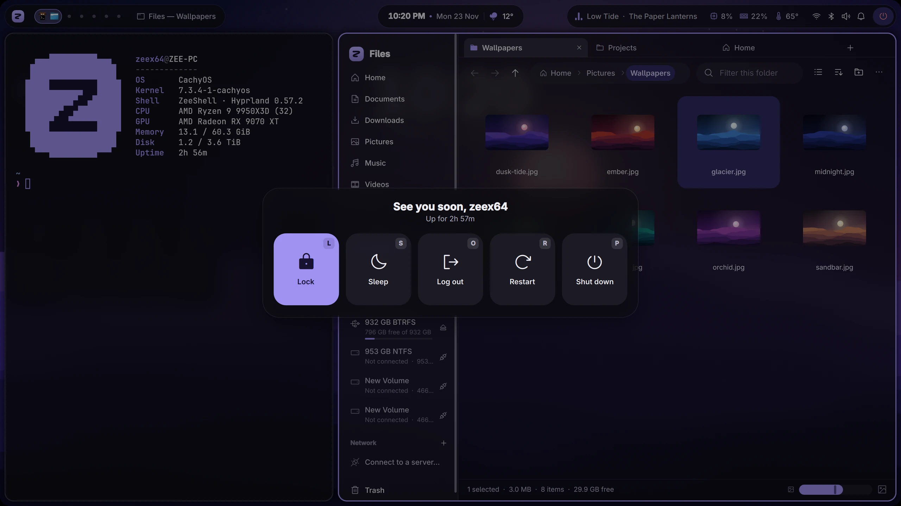
</p>

### Steam workspace (optional)

Steam lives in its own hidden workspace that one key (Super + G) drops over the
desktop. It can start with the session and stays loaded there. Off by default;
turn it on in Settings → Apps → Files & Steam.

## Requirements

| | |
| --- | --- |
| **Required** | Hyprland, Quickshell (the `qs` command), the Phosphor icon font (Arch: `ttf-phosphor-icons`) |
| **Optional** | `nmcli` (network), `brightnessctl` or `ddcutil` (brightness), `gammastep` (night light), `hyprshot`, `hyprpicker`, `curl` (wallpaper downloads), `plasma-apply-colorscheme` (colouring KDE apps), `udisksctl` and `gio` with gvfs (drives and servers in the file explorer, default apps), `vulkaninfo` or `glxinfo` (exact GPU name), `power-profiles-daemon` (power modes), `checkupdates` from pacman-contrib (the Updates page), systemd's `timedatectl` and `hostnamectl` (time zone, device name) |

ZeeShell is developed and tested on Hyprland 0.57 with its Lua config, using
[noctalia-qs](https://github.com/noctalia-dev/noctalia-qs) 0.0.12 on an
Arch-based system. It has not been tried on upstream Quickshell or other
distributions. With a classic `hyprland.conf` the shell works, but the keybind
editor and the Steam workspace are unavailable, and display and input settings
are applied when the shell starts instead of by Hyprland itself (that path has
not been tested).

`install.sh` checks all of this and tells you what is missing.

## Install

Clone this repository, then run:

```bash
./install.sh
```

It needs no root access, and sets everything up in one go. It:

1. copies the shell to `~/.config/quickshell/zeeshell`
2. adds a `zeeshell` command in `~/.local/bin`
3. adds "ZeeShell Files" to your app launchers
4. connects it to Hyprland: autostart and default keybinds go in
   `~/.config/hypr/zeeshell/`, and two marked blocks are added to
   `hyprland.lua` (or one `source` line to `hyprland.conf`)
5. sets up your terminals: kitty and foot get a colour file the shell keeps in
   step (one `include` line each), and fish, bash and zsh show the greeter in
   new terminals. A greeting you already had in `config.fish` is kept under the
   name `fish_greeting_before_zeeshell`.

Once the shell runs, it also colours KDE apps and writes a Vesktop theme; those
switches are in Settings → Personalisation → Appearance → Other apps. For the
see-through Vesktop window, Vesktop's own window transparency has to be on:
the same place has a button that switches it on and restarts Vesktop. The
Steam theme needs Millennium (tested with 3.7): choose "ZeeShell" once under
Steam → Millennium → Themes. Steam reads a theme when it starts, so new
wallpaper colours show there after its next restart.

Every file it changes is backed up first, everything it adds to your own files
sits between `>>> ZeeShell >>>` markers, and running it again changes nothing
that is already in place. Other options:

| Option | |
| --- | --- |
| `--link` | Symlink the repository instead of copying, so edits apply live |
| `--no-hyprland` | Leave the Hyprland config alone |
| `--no-terminal` | Leave terminals alone: no kitty/foot colours, no greeter |
| `--start` | Start the shell when done |
| `--dry-run` | Show what would happen without changing anything |
| `--uninstall` | Take all of the above back out and put your files back as they were |
| `--purge` | With `--uninstall`: also remove settings, your keybind file and the cache |

Only one shell should own the desktop. If you already run another bar or shell,
take it out of your autostart.

To remove ZeeShell again:

```bash
./install.sh --uninstall
```

## Using it

Default keys (change them in Settings → Input → Keybinds, or in
`~/.config/hypr/zeeshell/binds.lua`):

| Key | |
| --- | --- |
| Super + Space | App drawer |
| Super + A | Quick settings |
| Super + E | File explorer |
| Super + , | Settings |
| Super + / | Keybinding cheat sheet |
| Super + Shift + W | Wallpaper picker |
| Super + L | Lock |
| Super + Esc | Power menu |

Everything is scriptable through the `zeeshell` command; `zeeshell help` lists
it. A few examples:

```bash
zeeshell toggle launcher
```

```bash
zeeshell wallpaper ~/Pictures/Wallpapers/example.jpg
```

```bash
zeeshell restart
```

In the app drawer, type `/` for shell commands such as `/settings`, `/dark`,
`/volume 40` or `/screenshot`. `/settings` followed by a few words searches
Settings, for example `/settings refresh rate`.

## Where things live

| | |
| --- | --- |
| `~/.config/zeeshell/config.json` | Your settings. Reloaded the moment the file changes; unknown keys and wrong types are ignored. |
| `~/.config/hypr/zeeshell/binds.lua` | Autostart and default keybinds. Yours to edit; the installer never overwrites it. |
| `~/.config/hypr/zeeshell/generated.lua` | Binds made in Settings → Input → Keybinds. Rewritten by the shell. |
| `~/.config/hypr/zeeshell/system.lua` | The screen layout and input options kept in Settings. Rewritten by the shell; empty until you keep something there. |
| `~/.config/hypr/zeeshell/probe.lua`, `steam.lua` | Managed by the installer. |
| `~/.config/kitty/zeeshell.conf`, `~/.config/foot/zeeshell.ini` | Terminal colours. Rewritten by the shell. |
| `~/.cache/zeeshell/` | App usage counts, what Hyprland reports about its binds, and the greeter's cache. |

### How the keybind editor works

Hyprland does not report what a Lua-configured bind does, so `probe.lua` is
loaded first and records every `hl.bind` call as your config runs. The shell
reads that list. When you move, change or disable a bind, your own config files
are not edited: the change is written to `generated.lua`, which releases the old
keys and adds the new bind, and Hyprland is reloaded. Removing the change puts
the original back. Binds written as Lua functions can be switched off but not
moved.

### The file explorer

`zeeshell files [folder]` opens a window; run it again for another. It is a
separate process from the shell (`files.qml`), so the two cannot take each
other down. Pasting never overwrites: a second `notes.txt` becomes
`notes (2).txt`. Delete moves things to the trash; Shift + Delete removes them
for good, after asking. To make it your default file manager, turn on
Settings → Apps → Files & Steam → "Open folders with ZeeShell Files".

- **Tabs**: Ctrl + T opens one, Ctrl + W closes it, Ctrl + Tab switches, and
  middle-clicking a folder opens it in a tab behind the current one. Each tab
  keeps its own history and selection.
- **Favourites**: press + in the sidebar to add the current folder, or drag a
  folder onto the section.
- **Drives**: every partition with files on it is listed, connected or not.
  Connecting and disconnecting use `udisksctl` (udisks2), which asks for your
  password when the system requires it.
- **Network**: + adds a server by address (`smb://`, `sftp://`, `ftp://`,
  `dav://`, `nfs://`) through `gio mount`, so the matching gvfs backend has to
  be installed. Passwords are never typed into the explorer: when a server
  wants one, a terminal opens for it.

## Network use

ZeeShell contacts three services, and only for the feature in question:

- **Open-Meteo** for the forecast.
- **geojs.io** to look up an approximate location from your public IP address,
  if "Detect automatically" is on. Pin a city in Settings → Time & weather →
  Weather to avoid it.
- **wallhaven.cc** when you browse or download wallpapers there. An API key, if
  you add one, is stored in plain text in `config.json`.

## Lock screen

The lock uses PAM (`assets/pam/zeeshell`) and Hyprland's session lock. Try
`zeeshell lockPreview` first: it shows the screen without locking. If the shell
ever dies while the session is locked, Hyprland keeps the screen locked. Switch
to a TTY (Ctrl + Alt + F3), log in, and either start a locker again so you can
unlock through it (Hyprland needs `misc:allow_session_lock_restore` for that) or
end the session with `loginctl terminate-user $USER`.

## Development

```bash
./install.sh --link
```

links the repository into place, so saving a file reloads the running shell.

- `ZEE_DRY=1` makes an instance read-only: it never saves settings, writes into
  the Hyprland folder, changes other apps' themes or reloads Hyprland. Use it
  for throwaway test instances (`ZEE_DRY=1 qs -p path/to/test.qml`).
- `ZEE_NOGRAB=1` stops popups from taking the keyboard.
- `qs -p . ipc call zeedev debug` prints the state of the services.
- `qs -p . log` shows the log. Check it after an edit: a file that fails to
  load leaves the previous version running.

```
shell.qml        entry point, global shortcuts, IPC
config/          Config (settings), Theme (colours, shape, motion), icons
components/      buttons, sliders, panels, the Overlay base every popup uses
services/        audio, network, weather, notifications, keybinds, app themes…
files.qml        entry point of the file explorer
modules/         one folder per surface (bar, launcher, sidebar, settings, files…)
hypr/            what the installer puts in ~/.config/hypr/zeeshell
themes/          default kitty and foot colours, used until the shell writes its own;
                 themes/steam is the Steam theme the shell copies into Millennium
scripts/         system stats, the greeter, file-transfer and foot-theme helpers
assets/pam/      PAM stack for the lock screen
docs/            the logo and the screenshots on this page
```

Things that have bitten this codebase, on Qt 6.12 with a Quickshell built
against an older Qt:

- `Behavior` inside a `Singleton`, and Quickshell's `JsonAdapter`, both
  segfault. Theme colour fades and the config store are done by hand instead.
- A property whose name starts with `on` followed by a capital (`onAccent`) is
  read as a signal handler and silently evaluates to nothing.
- `left`, `right`, `top`, `bottom` and `layer` cannot be used as property or id
  names on an Item.

Issues and pull requests are welcome. When reporting a problem, say which
Hyprland and Quickshell versions you run.

## Credits

- Icons: [Phosphor](https://phosphoricons.com) (MIT). `config/Phosphor.js` is a
  name-to-codepoint table generated from `@phosphor-icons/web`.
- Weather: [Open-Meteo](https://open-meteo.com). Wallpapers: [wallhaven.cc](https://wallhaven.cc).
- The wallpapers in the screenshots were drawn for this page.

## License

ZeeShell is free software, licensed under the GNU General Public License,
version 3. See [LICENSE](LICENSE). It comes with no warranty.
